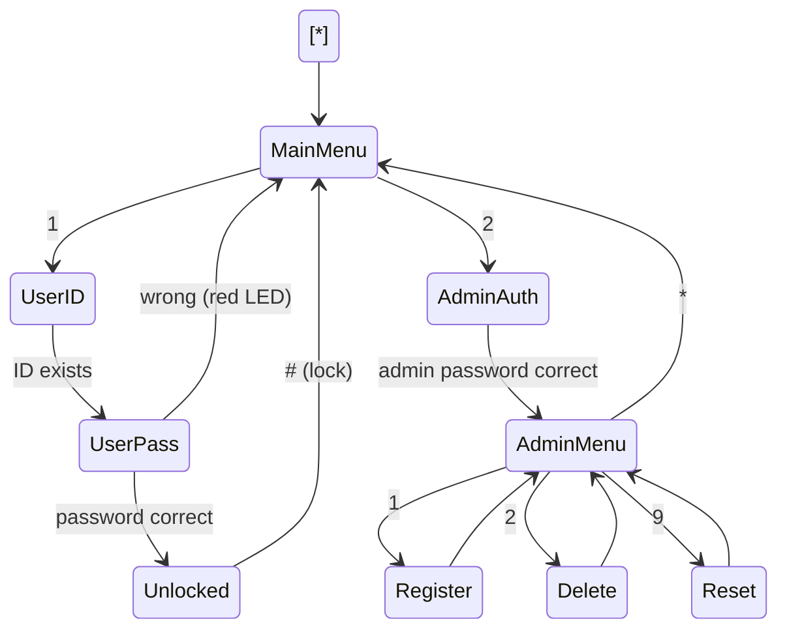

# AVR Password Door Lock (ATmega328P)

A multi-user keypad password door lock built on the **ATmega328P (8-bit AVR)** and written in **AVR assembly**. A 4x3 keypad and 16x2 LCD form the user interface, a servo acts as the lock, and passwords are stored in the on-chip **EEPROM** so they survive power-off. An admin menu lets you register users, delete users and clear the memory.

The design was developed and tested in **Proteus**, and a simple hardware version was then built on a dot board with the same components.

> Group project (3 members), January to April 2025, 3rd-year EEE, University of Peradeniya.

\---

## Features

* Multi-user login: user ID + 4-digit password (shown as `\*\*\*\*` on the LCD)
* Passwords stored in internal EEPROM (non-volatile)
* Admin menu: register user, delete user, reset memory
* Servo-based lock with locked / unlocked positions
* Green LED for access allowed, red LED for access denied
* Debounced 4x3 keypad scanning
* 16x2 HD44780 LCD driven in 4-bit mode
* Written entirely in AVR assembly (no libraries)

## How it works

|Key|Main menu action|
|-|-|
|`1`|User login|
|`2`|Admin login|
|`#`|Close (lock) the door|
|`\*`|Back / cancel|

**User login:** enter the user ID, then the 4-digit password. If it matches the 4 bytes stored in EEPROM, the LCD shows `Access Allowed`, the green LED turns on and the servo opens the lock. Otherwise it shows `Access Denied` and the red LED turns on.

**Admin menu** (after entering the admin password):

|Key|Action|
|-|-|
|`1`|Register a new user (next free ID is assigned automatically, then a 4-digit password is entered)|
|`2`|Delete a user (user ID, then admin password again to confirm)|
|`9`|Reset: clear all stored users|
|`\*`|Back|



## EEPROM memory map

|Address|Content|
|-|-|
|`0`|Number of registered users|
|`1 - 4`|Password of user 1 (4 bytes, ASCII)|
|`5 - 8`|Password of user 2|
|`4\*(n-1)+1 ...`|Password of user *n*|
|`0xFF` in first byte|Slot is empty|

## Hardware

|Part|Connection|
|-|-|
|LCD 16x2 (4-bit mode)|PORTC: data on PC0-PC3, RS on PC4, E on PC5|
|Keypad 4x3, rows (outputs)|PB0, PB1, PD6, PD7|
|Keypad 4x3, columns (inputs, pull-ups)|PB2, PB3, PB4|
|Servo (Timer0 fast PWM, OC0B)|PD5|
|Green LED (access allowed)|PD2|
|Red LED (access denied)|PD3|

Reference images are in [`docs/images`](docs/images): ATmega328P pinout, LCD and keypad.

<!-- Add hardware photos here if you have them, for example:
!\[Dot board build](docs/images/hardware.jpg)

## Repository structure

```
firmware/
  avr-assembly/        Final AVR assembly project (Microchip Studio)
  arduino-prototype/   Earlier Arduino prototypes used for Proteus simulation
simulation/            Proteus design (ATmega328p\_project\_sim1.pdsprj)
docs/images/           Pinout, LCD and keypad reference images
```

## Development history

1. **Arduino prototype in Proteus** (`simulation1`): single password, servo and LCD, with a fingerprint sensor simulated through the Proteus Virtual Terminal.
2. **Extended Arduino version** (`sim1`): state machine, up to 5 users with fingerprint ID plus password, EEPROM storage and an admin menu.
3. **AVR assembly rewrite** (`firmware/avr-assembly`): the final version on bare ATmega328P, using user ID plus password with EEPROM storage.

## How to run

**Simulation**

1. Install Proteus and Microchip Studio (Atmel Studio).
2. Open `firmware/avr-assembly/newEEPROMmodification.atsln` and build it (F7) to produce the `.hex` file. A prebuilt `.hex` is also attached to the [v1.0 release](../../releases).
3. Open `simulation/ATmega328p\_project\_sim1.pdsprj` in Proteus, double-click the ATmega328P, load the `.hex` as the program file, and run.

**Hardware:** flash the same `.hex` to an ATmega328P (for example with a USBasp or an Arduino used as ISP) and wire the parts as in the table above.

## Known limitations

* The admin password is hard-coded in the firmware (demo value `1234`).
* User passwords are stored as plain text in EEPROM, with no encryption.
* User IDs are entered with a single key press, so in practice there are at most 9 users.
* The fingerprint sensor appears only in the Arduino prototypes, as a simulated input.

## Team

* Mr. Venshgar S. (E/21/418)
* Mr. Harishraj T. (E/21/171)
* Ms. Selvakumar K. (E/21/367)

## License

MIT, see [LICENSE](LICENSE).

